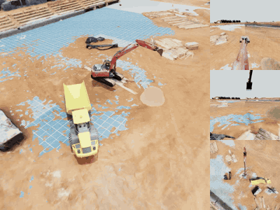
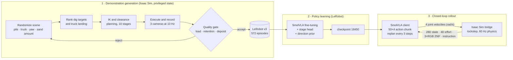
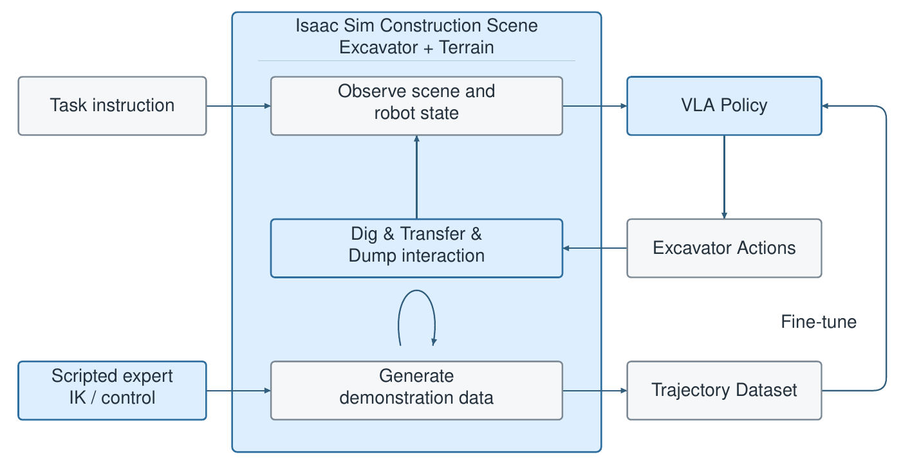
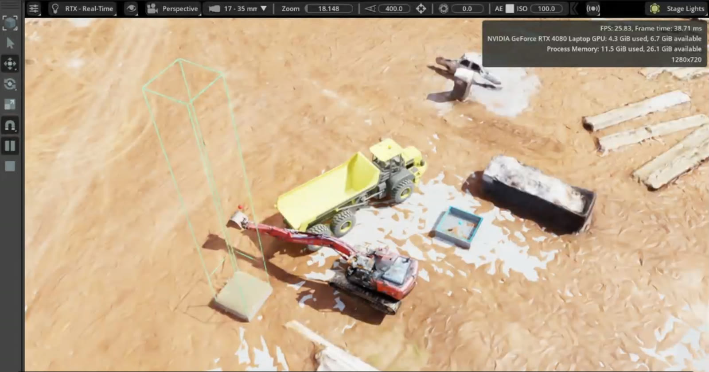
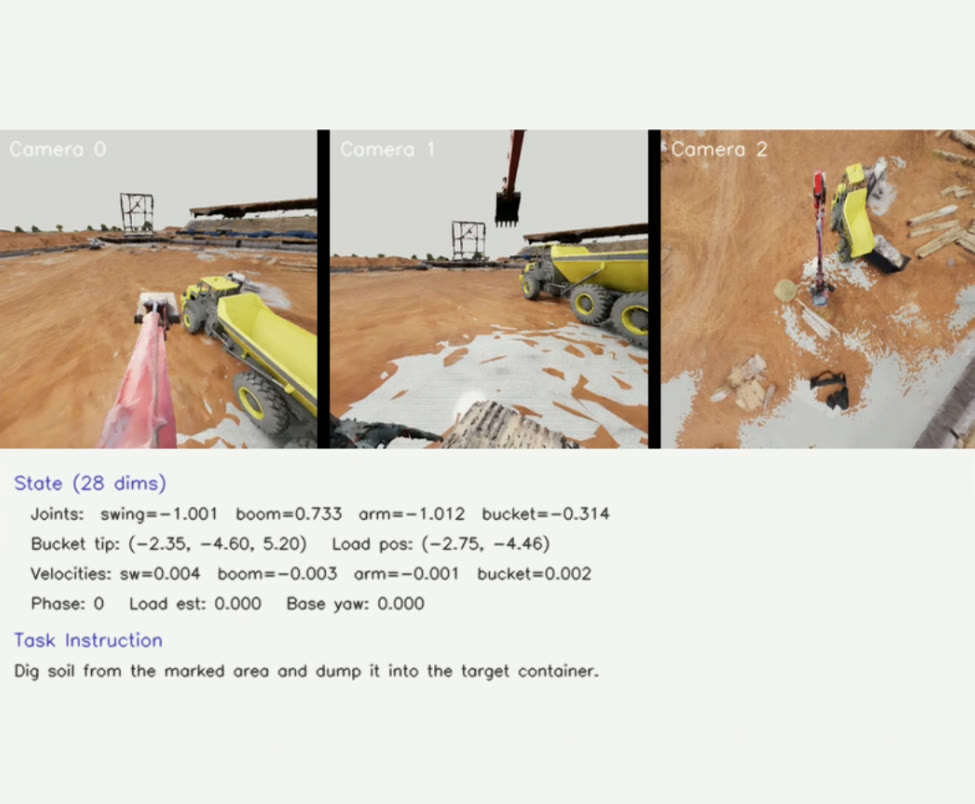
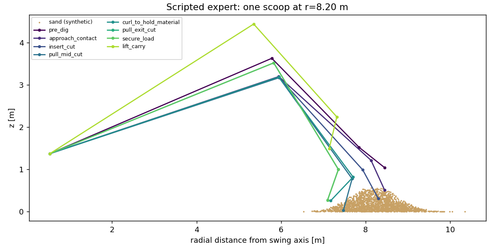

# Excavator VLA: Autonomous Excavation and Loading with a Vision-Language-Action Model

**ME 450 Capstone Design · Group 19 · Global College, Shanghai Jiao Tong University · Summer 2026**<br>
Sponsor: **Builder[x] Robotics** · Industry mentor: Shiji Liu · Faculty supervisor: Prof. Qianli Chen

**Project page:** [`index.html`](index.html). Open it locally, or enable GitHub Pages for this repository.

We present a simulation-based autonomous excavator that perceives its worksite through three
onboard cameras, receives a natural-language instruction, and completes a full **dig, transfer and
dump** cycle into a haul truck. The controller is **SmolVLA**, a compact Vision-Language-Action
model (SmolVLM2-500M backbone with a flow-matching action expert). We fine-tune it on demonstrations
generated automatically by a privileged scripted expert in NVIDIA Isaac Sim, with granular material
modelled as PhysX particles.

<p align="center">
  
  <br><sub><b>Closed-loop rollout</b> (checkpoint 18450, evaluation scene seed 2, 300 policy steps at 10 Hz; GIF shown at 2× speed).
  Left: 1024² overview camera, used for recording only. Right, top to bottom: the three 256² cameras observed by the policy.
  Full resolution: <a href="media/eval_4view.mp4">4-view</a> · <a href="media/eval_overview.mp4">overview</a> ·
  <a href="media/eval_camera_0.mp4">camera 0</a> · <a href="media/eval_camera_1.mp4">camera 1</a> · <a href="media/eval_camera_2.mp4">camera 2</a></sub>
</p>

> **Scope of this repository.** This repository is the public overview of the project. It contains
> the motivation, design process, results and media, together with a compact reference
> implementation of the core pipeline in [`excavator_vla/`](excavator_vla/). The development
> codebase spans five branches, two runtime environments and a 40,000-line Isaac Sim module; the
> reference implementation condenses it to about 2,000 lines that map one-to-one onto the
> production modules. The pure-Python components are executable and unit-tested. The Isaac Sim and
> LeRobot components document the production interfaces and require those toolchains to run.
> See [docs/original_repo_map.md](docs/original_repo_map.md).

---

## Results

The system meets all eight engineering specifications (final report, Table 7-1).

| ID | Specification | Target | Achieved |
| --- | --- | --- | --- |
| ES1 | Controllable task joints | 4 | **4** (swing, boom, arm, bucket) |
| ES2 | Closed-loop control frequency | > 2 Hz | **2.1 – 4.0 Hz** |
| ES3 | Policy-client response latency | ≤ 10 ms | **6.47 ms** (median) |
| ES4 | Simulation runtime performance | ≥ 15 FPS | **≥ 30 FPS** |
| ES5 | Material interaction level | ≥ Level 2 | **Level 3** (scoop and dump with measurable transfer) |
| ES6 | Valid demonstration trajectories | ≥ 50 | **572** episodes (62,216 frames) |
| ES7 | Mean cycle time | ≤ 210 s | **195.04 s** |
| ES8 | Autonomous success rate | ≥ 60 % | **83.5 %** (167 / 200 episodes) |

> [!IMPORTANT]
> The success rate was measured with a **bounded execution supervisor** enabled
> ([`policy/supervisor.py`](excavator_vla/policy/supervisor.py)). This deterministic layer constrains
> selected phases: committing to the cut, curling before lifting, and completing the swing and dump
> once a load is confirmed. The figure therefore characterises the deployed VLA *system* rather
> than the policy in isolation. Success is defined permissively: at least one particle deposited in
> the truck bed, evaluated in-domain, with one dig cycle per episode. See [docs/results.md](docs/results.md).

---

## Method



<p align="center"><br><sub>System architecture (final report, Illustration 5-1)</sub></p>

| | |
| --- | --- |
|  |  |
| Simulated construction site: excavator, material pile and haul truck | Policy observation: three camera views, robot state and task instruction |

**Simulation.** The worksite runs in Isaac Sim with GPU PhysX. A fixed-base, four-DOF excavator is
imported from a SolidWorks-exported URDF. The material is a PhysX particle system (45,000 particles,
"Soft Dig" preset), so the bucket genuinely scoops, carries, spills and deposits sand. Physics runs at
60 Hz; each policy action is held for six physics steps (10 Hz control). → [docs/simulation.md](docs/simulation.md)

**Scripted expert.** Using privileged access to every particle, the expert ranks candidate dig points
by reachability, expected fill, local density and required joint motion. It then solves analytic
inverse kinematics through a ten-stage scoop sequence (`pre_dig → approach_contact → insert_cut → … →
unload_to_bin`) and routes the loaded bucket around the truck with a clearance planner and RRT
fallback. A post-execution quality gate rejects any episode that fails to deliver material.
→ [docs/data_collection.md](docs/data_collection.md)

**Policy.** SmolVLA with a frozen SmolVLM2-500M-Video-Instruct vision encoder receives three 256²
RGB images, a **28D state** expressed in the excavator's upper-structure frame, a 4D joint-effort
vector and the instruction. It predicts a **50 × 4 chunk of joint velocities**. We add a
stage-classification head and two stage-conditioned auxiliary losses: a direction prior, and a swing
penalty while the bucket is engaged with the pile. → [docs/training.md](docs/training.md)

**Deployment.** A versioned TCP bridge operates in **deterministic lockstep**: the simulation is paused
during inference, so policy latency never accrues as simulated time. Before any motion, a handshake
validates feature names, dimensions, control rate and a hash of the normalization statistics.
→ [docs/deployment.md](docs/deployment.md)

---

## Repository structure

```text
index.html                     project page (self-contained; works with GitHub Pages)
excavator_vla/                 reference implementation (~2k lines; mirrors the production modules)
├── contract.py                observation / action / stage contract (28D state, 10 stages)
├── protocol.py                bridge protocol: framing, handshake, drift-free tick scheduler
├── kinematics.py              planar IK with bucket-angle search; floor-safe cutting depth
├── randomization.py           reproducible per-worker scene sampling
├── expert/                    dig planner · quality gates · collection loop · parallel launcher
├── data/lerobot_export.py     LeRobot v3 export with hold-aware action derivation
├── sim/                       Isaac Sim bridge server, scene and camera specification, particle presets
├── policy/                    SmolVLA client · chunk replanning and ensembling · supervisor · success check
├── training/stage_losses.py   stage head, direction-prior and low-motion losses
└── evaluation/                offline metrics · open-loop chunk-stitching analysis
configs/                       evaluation scene (seed 2) · training configuration
scripts/                       01 collect → 02 train → 03 deploy (reference launchers)
examples/plan_one_scoop.py     standalone example: plans a scoop on a synthetic pile and plots it
tests/                         unit tests for the pure-Python modules
docs/                          technical documentation
media/                         rollout videos, frames and figures
```

### Running the executable components

```bash
pip install numpy matplotlib
python -m unittest discover -s tests -t .      # contract, protocol, IK, seeding, ensembling, supervisor
python examples/plan_one_scoop.py              # writes media/generated/plan_one_scoop.png
```

<p align="center"></p>

---

## Documentation

| Document | Contents |
| --- | --- |
| [docs/design_process.md](docs/design_process.md) | Problem definition, customer requirements, QFD, concept generation and selection, schedule |
| [docs/simulation.md](docs/simulation.md) | Scene, URDF-to-USD import, particle material, cameras, timing budget |
| [docs/data_collection.md](docs/data_collection.md) | Scripted expert, ten-stage scoop, IK, clearance planning, quality gates, parallel collection |
| [docs/dataset_contract.md](docs/dataset_contract.md) | Dataset features, dimensions, units and frames of reference |
| [docs/training.md](docs/training.md) | Fine-tuning schedule, auxiliary losses, offline evaluation |
| [docs/deployment.md](docs/deployment.md) | Bridge protocol, lockstep execution, inference loop, supervisor, recording |
| [docs/results.md](docs/results.md) | Specification verification, timing, success-rate study, limitations, future work |
| [docs/original_repo_map.md](docs/original_repo_map.md) | Correspondence between this implementation and the development repository |

---

## Team

| Member | Responsibility |
| --- | --- |
| Lingxiao Yang | Terrain and material interaction; soil simulation |
| Xirui Jiang | Scene setup; simulator–backend communication; VLA adaptation and training |
| Haoyun Pan | Documentation and reporting; server maintenance |
| Runting Zhang | VLA training and evaluation |
| Seak Pang Zou | Scripted expert design; IK and control; trajectory generation |

## Acknowledgements

We thank Builder[x] Robotics and Shiji Liu for sponsoring and guiding the project, and Prof. Qianli
Chen for faculty supervision. This work builds on [NVIDIA Isaac Sim](https://developer.nvidia.com/isaac/sim),
[LeRobot](https://github.com/huggingface/lerobot) and [SmolVLA](https://huggingface.co/lerobot/smolvla_base).
The 15 GB demonstration dataset (LeRobot v3) is distributed separately from this repository.
