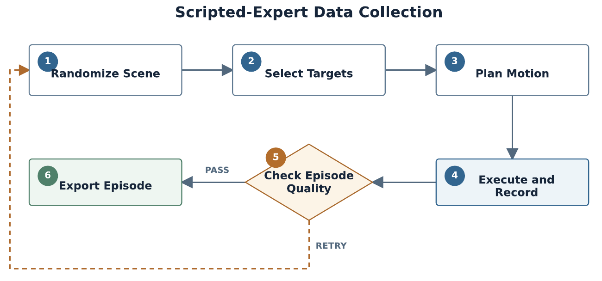
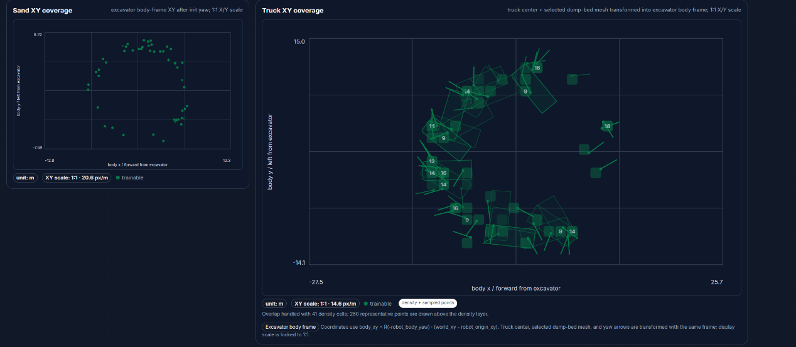
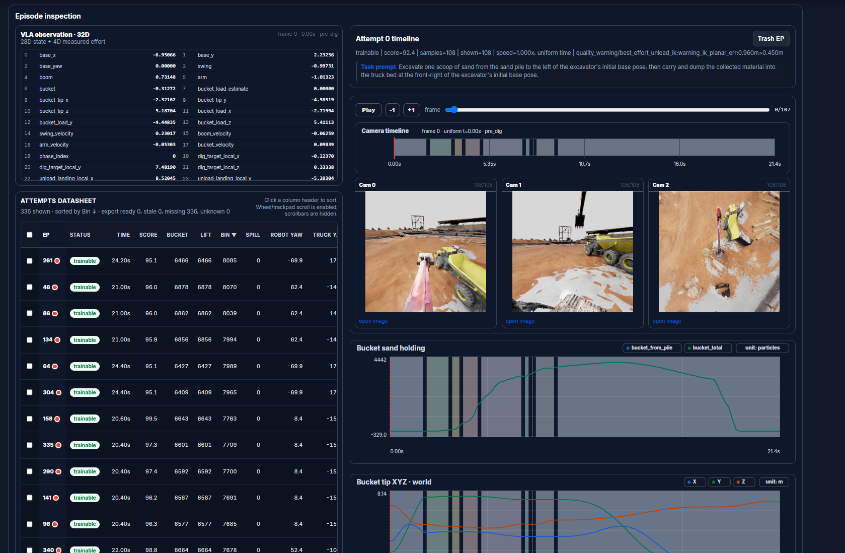
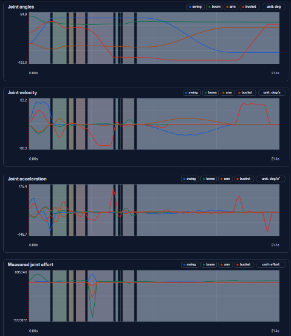

# Demonstration generation: the scripted expert

Implementation: [`excavator_vla/expert/`](../excavator_vla/expert/), [`kinematics.py`](../excavator_vla/kinematics.py),
[`randomization.py`](../excavator_vla/randomization.py)



Teleoperating a four-DOF excavator in simulation is slow and yields inconsistent demonstrations. We
instead generate demonstrations with a **scripted expert** that has privileged access to the position
of every particle. It records exactly what the policy will later observe: three camera streams, the
28D state, joint effort and the task instruction, sampled on a 10 Hz simulation-time grid.

## 1 · Scene randomization

| Quantity | Range |
| --- | --- |
| Excavator yaw | −170° to 170° |
| Pile centre | radius 5.8 – 7.35 m, bearing 82° – 98° |
| Material quantity multiplier | 3 – 15 |
| Truck | radius 8.0 – 10.8 m, bearing −170° to −120°, ±1.2 m jitter, tailgate facing the excavator within ±90° |
| Constraints | pile-to-unload distance ≥ 6.0 m; excavator-to-truck distance ≥ 3.5 m; ≥ 3,000 particles; at most 96 attempts |

Each scene seed is derived as `SHA-256(base seed, run ID, worker ID, attempt)`, so any episode from any
parallel worker can be reproduced exactly. Radii are sampled uniformly over area.



## 2 · Target selection

* **Dig point.** A 7 × 7 grid is laid over the pile. Cells with fewer than 24 particles within 0.34 m
  are discarded. The remaining cells are scored as
  `32·reach + 26·fill + 22·swept density + 12·depth + 10·centrality + 8·approach + 6·motion`.
  The eight best are retained, the top three are planned in full, and the plan with the lowest total
  weighted joint motion is executed.
* **Unload point.** A 5 × 5 grid covers the truck bed with a 0.60 m wall margin. The point with the
  lowest current fill height is chosen, with ties broken by distance to the bed centre. The release
  height is approximately 1.45 m above the bed floor.

## 3 · Ten-stage scoop

| # | Stage | Effector | Bucket angle (world) | Purpose |
| --- | --- | --- | --- | --- |
| 0 | `pre_dig` | tip | −25° (travel) | position above the dig point |
| 1 | `approach_contact` | tip | −52° (attack) | contact the surface |
| 2 | `insert_cut` | tip | −48° | penetrate to the floor-safe depth |
| 3 | `pull_mid_cut` | load point | −92° | drag through the material toward the cab |
| 4 | `curl_to_hold_material` | load point | −120° (joint) | curl to retain the material |
| 5 | `pull_exit_cut` | load point | −96° | exit the pile |
| 6 | `secure_load` | load point | held | allow the material to settle |
| 7 | `lift_carry` | load point | held | lift with the bucket locked |
| 8 | `loaded_transit` | load point | 18° mouth-up (carry) | follow a clearance route toward the truck |
| 9 | `unload_to_bin` | load point | 45° for 0.9 s (dump) | release over the truck bed |

Stage labels are exported for supervision only. The policy never receives the stage as an input.

## 4 · Inverse kinematics and safety

* **Decomposition.** Swing is obtained in closed form as `atan2` of the target. Boom, arm and bucket
  then form a planar three-link chain.
* **Priority IK.** Candidate bucket world angles are enumerated. For each candidate, the bucket link is
  subtracted to obtain a wrist target, and boom and arm are solved analytically for both elbow
  branches. Solutions are rejected if they place the boom or arm below the ground clearance, drive the
  tip too deep, or violate joint limits. The solution with the lowest weighted joint motion, using
  weights [1.15, 1.0, 0.9, 0.7], is selected.
* **Floor-safe depth.** For the bucket angle used in each cutting stage, the planner computes the
  lowest effector height that keeps every bucket reference point above its floor limit: tip depth at
  most 0.28 m, bucket-body depth at most 0.10 m. The cutting depth is the shallower of the desired
  depth and this bound.
* **Clearance planning.** Loaded transit first attempts raised waypoints that clear the maximum
  obstacle height along the swing corridor. If none is feasible, it falls back to a seeded four-DOF
  RRT-Connect (13° step, goal bias 0.18, at most 220 iterations) with shortcut smoothing. The bucket
  remains locked at the carry angle throughout.

## 5 · Quality gates

Each episode must pass three gates:

1. **Scene gate.** Reachability, overlap and particle count.
2. **Planning gate.** A complete, feasible plan must exist.
3. **Post-execution quality gate**, defined as follows:

```text
score = 35·dig_load + 30·dump_transfer + 15·retention + 10·smoothness + 10·completion − min(20, 20·spill_ratio)

reject if  peak bucket load < 5  or  lifted load < 5  or  truck gain < 3
        or spill ratio > 0.30   or  score < 70        or  any joint stall
```

A joint is considered stalled when it is more than 2° from its command while moving less than 0.12°,
which typically indicates the bucket is jammed in the material.

## 6 · Parallel collection

Isaac Sim's Kit, RTX and PhysX state is process-global, so each worker runs as a **separate headless
Isaac Sim process** with its own seed suffix (`w00`, `w01`, …), GPU assignment and log file. Worker
start-up is staggered by 5 s. A web dashboard supports browsing runs, plotting joint trajectories and
reviewing camera streams. Accepted episodes are promoted to an immutable pool, which is exported to
LeRobot v3 in a single pass.

| | |
| --- | --- |
|  |  |
| Episode inspector dashboard | Joint position, velocity, acceleration and effort |

The final training set comprises **572 accepted episodes and 62,216 frames** (15 GB including video).
