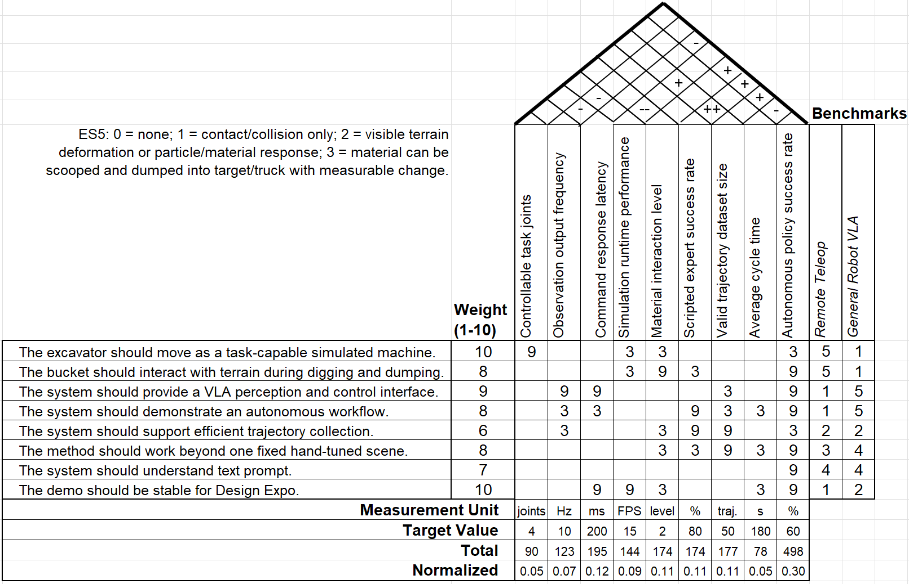
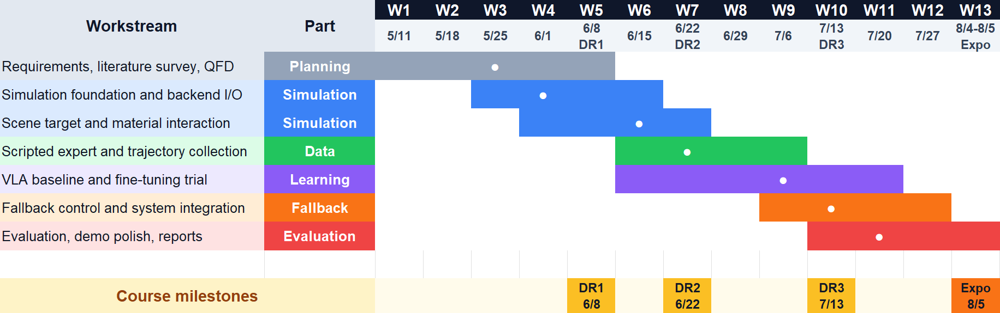

# Design process

## Problem statement

Excavators are central to construction, mining and earthmoving. On-site operators, however, are
exposed to dust, unstable terrain, falling objects and limited visibility. Builder[x]'s teleoperation
platform moves the operator off site, but **remote excavation and loading reaches only about 70 % of
on-site efficiency**, a gap attributed to reduced scene understanding and to communication latency.
Teleoperation also still requires the continuous attention of a skilled operator.

**Objective.** Develop an autonomous excavation-and-loading system that reduces dependence on
continuous human control. The project is a simulation proof of concept. Hydraulic dynamics, sensor
uncertainty, safety control and sim-to-real transfer are outside its scope.

**Research gap.** Vision-Language-Action (VLA) models such as RT-2, OpenVLA, π0.5 and SmolVLA have
been demonstrated predominantly on tabletop manipulators rather than on excavator digging and
loading. Prior excavator autonomy, including AES (2021), soil-adaptive reinforcement learning (2022)
and ExACT (2024), relies on task-specific pipelines or on imitation learning without language
conditioning.

## Customer requirements and engineering specifications

| ID | Customer requirement | Weight (1–10) |
| --- | --- | --- |
| CR1 | Task-capable simulated machine | 10 |
| CR2 | Bucket–terrain interaction | 8 |
| CR3 | VLA perception and control interface | 9 |
| CR4 | Autonomous workflow | 8 |
| CR5 | Efficient trajectory collection | 6 |
| CR6 | Operation beyond a single hand-tuned scene | 8 |
| CR7 | Understanding of a text instruction | 7 |
| CR8 | Stable demonstration at the Design Expo | 10 |

A QFD analysis (relationship scores 9, 3 and 1 for strong, medium and weak) produced the following
normalized specification priorities:

| ES8 success rate | ES3 latency | ES6 dataset size | ES5 material | ES4 FPS | ES2 loop rate | ES1 joints | ES7 cycle time |
| --- | --- | --- | --- | --- | --- | --- | --- |
| **0.34** | 0.13 | 0.12 | 0.12 | 0.10 | 0.08 | 0.06 | 0.05 |

**Material interaction levels (ES5):**

* **Level 0:** no interaction.
* **Level 1:** contact or collision only.
* **Level 2:** visible deformation or particle response.
* **Level 3:** material can be scooped and deposited, with measurable change.

## Concept generation

Functional decomposition identified four design decisions. A morphological chart enumerated the
options for each:

| Function | Options |
| --- | --- |
| A · Simulation environment | Isaac Sim · MuJoCo · Unity |
| B · Control strategy | End-to-end VLA · hierarchical (VLA with a low-level controller) |
| C · Data acquisition | Scripted expert · human teleoperation · scripted expert with bucket-control specialist |
| D · Material model | Particles · height map · small rigid blocks |

Five candidate concepts were formed:

| Concept | Combination |
| --- | --- |
| C1 | MuJoCo · hierarchical · scripted expert · height map |
| C2 | Unity · end-to-end · teleoperation · height map |
| **C3** | **Isaac Sim · end-to-end VLA · scripted expert · particles** |
| C4 | Isaac Sim · hierarchical · scripted expert with bucket specialist · particles |
| C5 | Isaac Sim · end-to-end · scripted expert · rigid blocks |

## Concept selection

Concepts were scored from 1 to 4 against the six highest-priority specifications, with weights
renormalized over those six.

| Criterion | Weight | C1 | C2 | C3 | C4 | C5 |
| --- | --- | --- | --- | --- | --- | --- |
| ES8 success rate | 0.38 | 3 | 2 | 4 | 3 | 2 |
| ES3 latency | 0.15 | 4 | 2 | 3 | 3 | 3 |
| ES6 dataset size | 0.14 | 3 | 2 | 4 | 4 | 4 |
| ES5 material interaction | 0.13 | 2 | 2 | 4 | 4 | 1 |
| ES4 simulation FPS | 0.11 | 4 | 2 | 3 | 3 | 4 |
| ES2 loop rate | 0.09 | 4 | 2 | 3 | 3 | 3 |
| **Weighted total** | | 3.22 | 2.00 | **3.65** | 3.27 | 2.61 |

**C3 was selected** as the only concept strong in all three defining areas: VLA-compatible inputs and
outputs, automated demonstration generation, and meaningful material transfer. C4 was retained as the
fallback. Its low-level controller, however, would have reduced the contribution attributable to the VLA.

A brief MuJoCo prototype (URDF-to-MJCF conversion) was explored early in the project. It was not
pursued further because MuJoCo lacks granular-material support comparable to PhysX particles.

## Schedule

| Milestone | Date | Outcomes |
| --- | --- | --- |
| Design Review 1 | 2026-06-08 | Problem definition, benchmarking, QFD, proposed approach (Isaac Sim, scripted expert, SmolVLA), project plan |
| Design Review 2 | 2026-06-22 | Concept selection; Isaac Sim scene and simulator–backend communication operational; zero-shot SmolVLA found unusable, motivating project-specific demonstrations |
| Design Review 3 | 2026-07-13 | Bridge and scripted expert complete; first three-camera dataset; fine-tuning under way; timing and particle-count studies |
| Final report | 2026-08-03 | All engineering specifications verified |
| Design Review 4 / Design Expo | 2026-08-05 | Closed-loop demonstration; 83.5 % success over 200 episodes |

