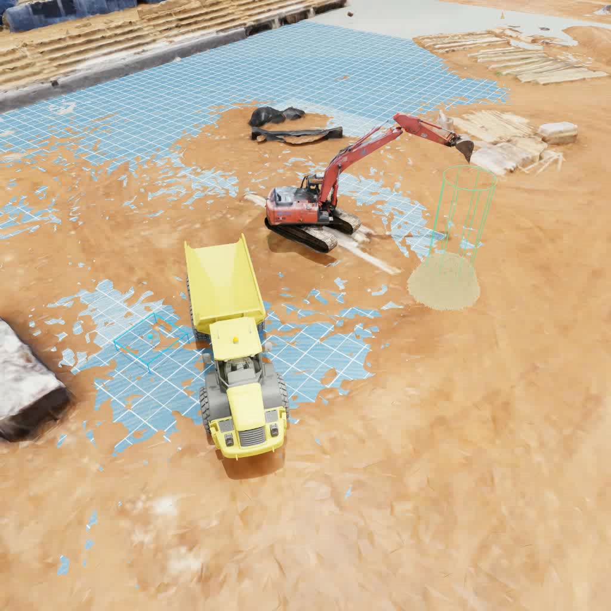
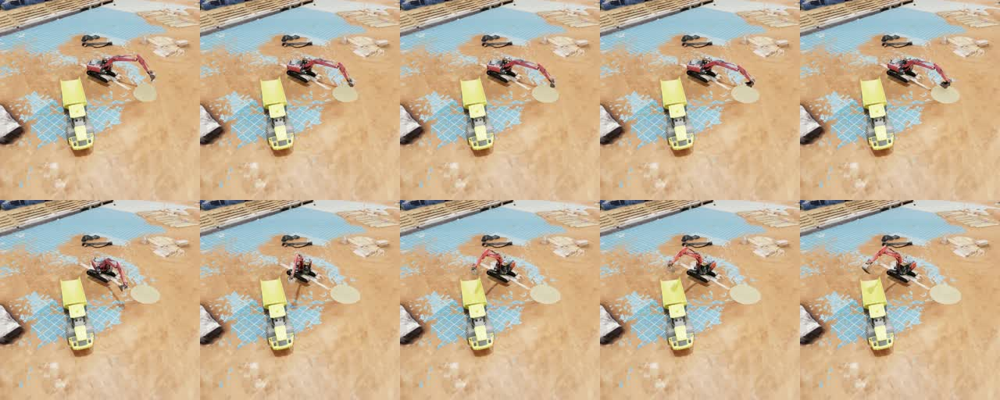

# Results

## Specification verification

| ID | Specification | Target | Result | Method |
| --- | --- | --- | --- | --- |
| ES1 | Controllable task joints | 4 | 4 | articulation inspection |
| ES2 | Closed-loop control frequency | > 2 Hz | 2.1 – 4.0 Hz | per-component timing |
| ES3 | Policy-client response latency | ≤ 10 ms | 6.47 ms (median) | client timing on an L40S |
| ES4 | Simulation runtime performance | ≥ 15 FPS | ≥ 30 FPS | simulator timing |
| ES5 | Material interaction level | ≥ Level 2 | Level 3 | particles scooped and deposited |
| ES6 | Valid demonstration trajectories | ≥ 50 | 572 | dataset count |
| ES7 | Mean cycle time | ≤ 210 s | 195.04 s | 167 successful rollouts |
| ES8 | Autonomous success rate | ≥ 60 % | 83.5 % | 200 rollouts |

## Closed-loop evaluation

* **Protocol.** 200 completed episodes in the fixed evaluation scene (seed 2), using checkpoint 18,450.
  Each episode makes one dig–transfer–dump attempt of at most 350 control steps, with replanning every
  three steps, ensemble width 1, the supervisor enabled and no manual intervention.
* **Outcome.** **167 successes and 33 failures (83.5 %).**
* **Success criterion.** At least one particle from the initial pile lies in the truck bed, the count
  remains unchanged for three consecutive steps, and the bucket is open. The criterion is automatic but
  deliberately permissive.

Time from launch to success over the 167 successful episodes:

| Minimum | Mean | Median | 95th percentile | Maximum |
| --- | --- | --- | --- | --- |
| 142.74 s | 195.04 s | 177.15 s | 260.97 s | 269.11 s |

Cycle time is measured from simulation launch, so it includes scene loading and camera warm-up.

Rollout keyframes at 3 s intervals:

## Limitations

* **Execution supervisor.** A bounded execution safeguard was active during evaluation. The reported
  success rate therefore characterises the deployed system configuration rather than the policy alone.
* **In-domain evaluation.** The evaluation scene matches the refinement data, and background,
  lighting and material appearance are not varied.
* **Single cycle.** Episodes cover one excavation cycle. There is no repeated loading, pile
  management, temporal memory or recovery behaviour.
* **Permissive success metric.** Payload, bucket fill and spillage are not scored.
* **Failure analysis.** The 33 failures were not categorized, because the raw traces were not retained.
* **Physical fidelity.** The particle model is not calibrated against terramechanics. Hydraulics and
  sim-to-real transfer are not addressed.

## Future work

* Broaden visual and geometric randomization, and evaluate on held-out domains.
* Score deposited mass, bucket fill and spillage, and log the first failed stage with a reason code.
* Extend demonstrations to multiple cycles with retargeting, pile levelling and recovery.
  Adaptive multi-scoop collection is already implemented in the data pipeline.
* Add a short observation and action history with a compact task state, with the aim of removing
  the supervisor.
* Apply reinforcement-learning fine-tuning after imitation learning, and accelerate camera rendering,
  which accounts for 70–80 % of loop time.
