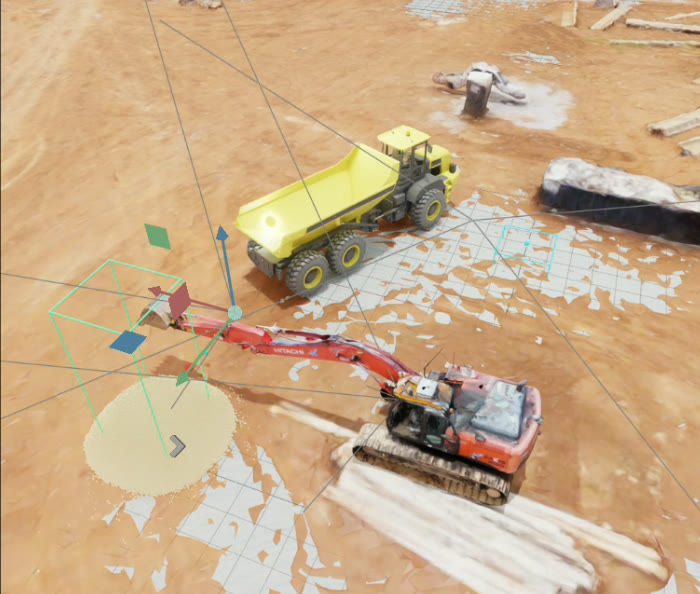
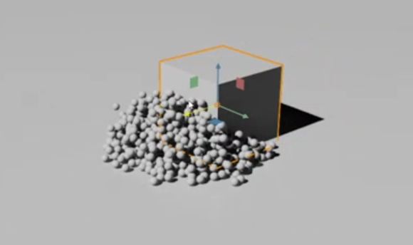
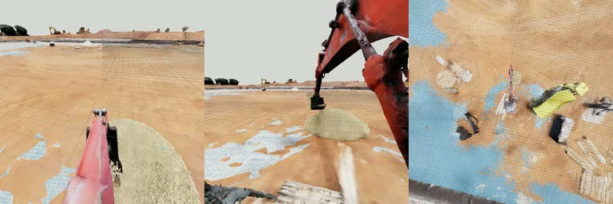

# Simulation

Implementation: [`excavator_vla/sim/`](../excavator_vla/sim/)

## Scene

* **Engine.** NVIDIA Isaac Sim with GPU PhysX. The scene (`excavator_scene.usd`) combines a
  construction-site environment with an HDR sky.
* **Excavator.** A SolidWorks-exported URDF (`URDF_real3`) converted to a USD articulation. The base is
  fixed, with four revolute joints in the canonical order **[swing, boom, arm, bucket]**. Runtime joint
  limits replace the URDF's ±90°: boom ±75°, arm ±95°, bucket −120° to 90°.
* **Haul truck.** Its 2.5 m × 2.5 m bed defines the volume in which deposited material is counted.
* **Material region.** 2.5 m × 2.5 m interior, bounded by 0.05 m walls, 0.60 m high.
* **Control.** Physics runs at 60 Hz. Each policy action spans six physics steps (0.1 s). At every step,
  the commanded velocity is integrated into a joint position target (`q_target += v·Δt`), clipped to
  the joint limits, and tracked by stiff PD drives. Drive stiffness ranges from 6 × 10⁶ for the bucket
  to 1.8 × 10⁷ for swing.

## Granular material

A height map cannot represent scooping and dumping, and rigid blocks tend to jam the bucket. We
therefore model the material as a **PhysX particle system**, which reaches material interaction
level 3. All data and evaluations use the "Soft Dig" preset:

| Parameter | Value | Parameter | Value |
| --- | --- | --- | --- |
| Viscosity | 0.85 | Static / dynamic friction | 0.85 / 0.82 |
| Cohesion | 0.035 | Particle friction scale | 0.90 |
| Adhesion | 0.015 | Restitution | 0 |
| Damping | 0.45 | Maximum particle speed | 12 m/s |

| Resolution | Particles | Spacing | Radius | Solver iterations |
| --- | --- | --- | --- | --- |
| **Efficiency (selected)** | 45,000 | 85 mm | 32 mm | 16 |
| Realistic | 260,000 | 34 mm | 14 mm | 24 |

The particle count interpolates between the two settings as `N = A · [(1 − f)·45,000 + f·260,000]`.

* **Bucket load** is the number of particles inside a closed collision mesh of the bucket cavity.
* **Deposited load** is the number of particles from the initial pile that lie within the truck-bed volume.

To avoid violent contact during initialization, the excavator is raised while particles are spawned
and allowed to settle, then lowered into position.

## Cameras

| Key | Mount | View | Pose (translation / rotation) |
| --- | --- | --- | --- |
| `observation.images.0` | arm link | bucket close-up | (0, 0, 0.45) m / (0, −60, 0)° |
| `observation.images.1` | upper structure | forward | (0, −1.2, 1.4) m / (65, 0, 0)° |
| `observation.images.2` | upper structure | elevated overhead | (0, 0, 3.0) m / (0, −70, 0)° |
| overview | world | recording only, not a policy input | 1024² |

Policy cameras render at 1024² and are downsampled to 256² with a Lanczos filter.

**Frame synchronization.** Every capture follows a fixed order: physics step with rendering, then an
explicit camera tick, then image readout. Omitting the tick returns the previous frame, which
corrupted early datasets with stale and duplicated images. Every recorded row is now required to
contain fresh, distinct, non-black frames from all three cameras. A camera fault halts collection
rather than producing a corrupted episode.

## Timing budget

Measured on an NVIDIA L40S (final report, Table 5-1):

| Component | Time | Share |
| --- | --- | --- |
| Physics (six steps) | ≈ 33 ms | ≈ 10 % |
| **Three-camera rendering and capture** | **200 – 400 ms** | **70 – 80 %** |
| Image encoding | 5 – 15 ms | ≈ 3 % |
| TCP transport | 2 – 5 ms | ≈ 1 % |
| Policy inference | 2 – 3 ms | < 1 % |
| **Total** | **250 – 470 ms** | **2.1 – 4.0 Hz** |

Policy inference is the least expensive stage of the loop, and rendering dominates. Because execution
is deterministic lockstep, these costs affect wall-clock time only, not closed-loop behaviour.
