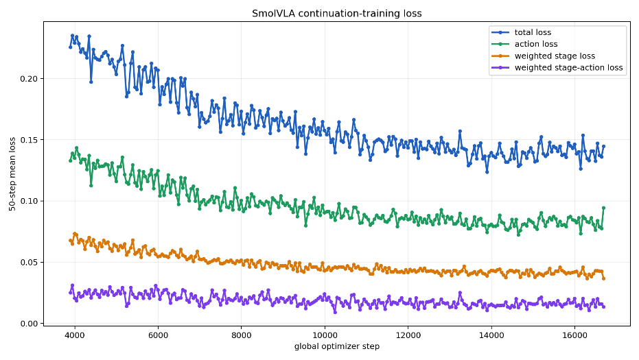
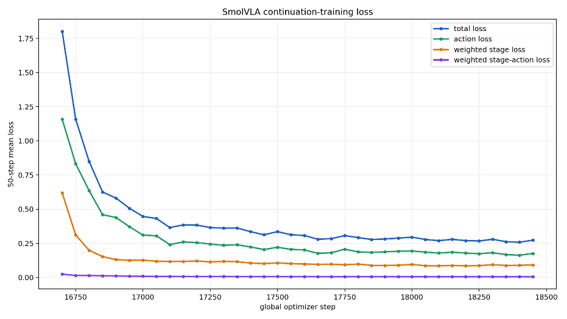

# Policy learning

Implementation: [`excavator_vla/training/stage_losses.py`](../excavator_vla/training/stage_losses.py),
[`configs/train_smolvla.yaml`](../configs/train_smolvla.yaml),
[`scripts/02_train_smolvla.sh`](../scripts/02_train_smolvla.sh)

## Model choice

OpenVLA has 7 billion parameters and was pretrained on 970,000 demonstrations. π0.5 is of
comparable scale. **SmolVLA** follows the same design, a pretrained vision-language model paired
with a flow-matching action expert that outputs action chunks, at roughly 0.5 billion parameters.
This fits the project's compute budget (1,540 CNY of rented GPU time) and keeps inference far from
the critical path: about 2.4 ms per forward pass on an NVIDIA L40S.

A zero-shot evaluation at Design Review 2 showed that the pretrained model was not usable for
excavation. This motivated the project-specific demonstration pipeline.

## Inputs and outputs

```text
3 × RGB 256² ─┐
instruction ──┼─► SmolVLM2-500M (vision frozen) ──► prefix KV cache ─┐
28D state ────┤                                                     ├─► action expert (flow matching)
4D effort ────┘   (state projection, trained)                        │       ├─► 50 × 4 joint velocities
                                                                     │       └─► 50 stage logits (added head)
```

## Fine-tuning schedule

All stages use AdamW with a learning rate of 5 × 10⁻⁵ and a batch size of 144.

| Stage | Data | Checkpoints |
| --- | --- | --- |
| Broad training | 567 episodes · 61,406 frames · 18 instruction variants | pretrained → 3,840 → 16,650 |
| Fixed-scene refinement | 5 episodes in the evaluation scene · 810 frames (6 steps per epoch) | 16,650 → **18,450** (300 epochs) |

The refinement episodes are training data, not a held-out set, so the subsequent evaluation is
in-domain by design.

| | |
| --- | --- |
|  |  |
| Broad training: total, action, stage and stage-action losses | Fixed-scene refinement |

## Auxiliary objectives

With the standard objective alone, the policy reproduced the average motion but confused task
phases, for example by swinging toward the truck while still cutting. We add three auxiliary terms:

| Term | Weight | Rationale |
| --- | --- | --- |
| Stage head: cross-entropy over the next 50 stage labels | 0.5 (×10 for rare stages) | gives the action expert an explicit notion of task progress |
| Stage-conditioned direction prior, `relu(−d_prior · a)` | 0.20 | penalizes velocities whose sign contradicts the expert's typical direction in the current stage |
| Low-motion penalty on swing during dig and lift stages | 0.5 (margin 0.10) | discourages rotating the upper structure while the bucket is engaged with the pile |

## Offline evaluation

[`evaluation/metrics.py`](../excavator_vla/evaluation/metrics.py) compares each frame's 50-step
prediction with the expert's next 50 actions. It reports within-tolerance accuracy, **sign
accuracy**, per-joint mean absolute error, stage accuracy and stage macro-F1.

[`evaluation/chunk_stitch.py`](../excavator_vla/evaluation/chunk_stitch.py) simulates executing only
the first *k* actions of each chunk, for k ∈ {1, 2, 3, 5, 10, 15, 20, 30, 50}. This quantifies how
quickly open-loop accuracy degrades with execution horizon and motivated **replanning every three
steps** at deployment. As a built-in consistency check, k = 1 must reproduce the per-frame evaluator exactly.
